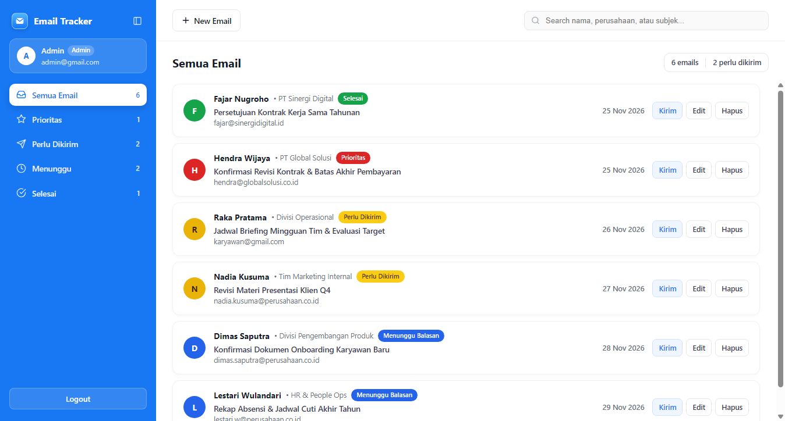
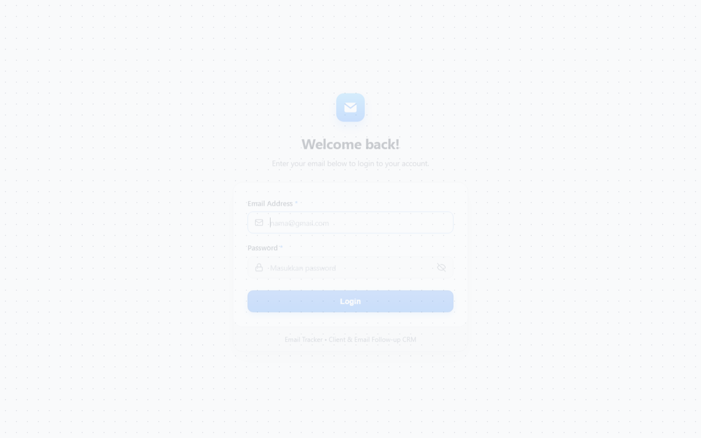
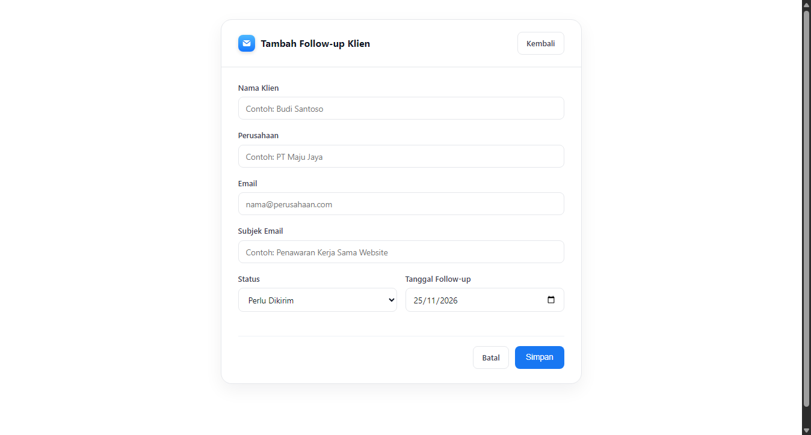

# Email Tracker (Mini CRM)

**Email Tracker** adalah aplikasi web **Mini CRM** berbasis **PHP & MySQL** untuk mencatat, mengelompokkan, dan memantau jadwal *follow-up* email kepada klien atau tim agar tidak ada pesan penting yang terlewat.

---

## Tampilan Demo

### Dashboard Utama


### Halaman Login


### Form Tambah Follow-up


---

## Fitur Utama

- **Autentikasi Session**: Halaman login dengan verifikasi password ter-hash (`password_hash` / `password_verify`) dan proteksi session di seluruh halaman CRUD.
- **Klasifikasi 4 Status Follow-up**:
  - **Prioritas** (Merah) — email penting yang harus segera ditindaklanjuti.
  - **Perlu Dikirim** (Kuning) — pengingat email yang belum dikirim.
  - **Menunggu Balasan** (Biru) — email yang sudah dikirim dan menunggu respons.
  - **Selesai** (Hijau) — komunikasi yang sudah tuntas.
- **Pencarian & Filter Cepat**: Filter berdasarkan status di sidebar kiri serta pencarian berdasarkan nama klien, perusahaan, atau subjek email.
- **Pengurutan Jadwal Otomatis**: Daftar diurutkan berdasarkan tanggal *follow-up* terdekat.
- **CRUD Lengkap & Kirim Email Cepat**: Tambah, edit, hapus data klien, serta tombol **Kirim** (`mailto:`) yang otomatis mengisi alamat tujuan dan subjek email.
- **Keamanan Dasar**: Menggunakan *MySQLi Prepared Statements* untuk mencegah SQL Injection dan `htmlspecialchars` untuk mencegah XSS.

---

## Struktur Proyek

```text
Email Tracker/
├── assets/
│   ├── demo-dashboard.png
│   ├── demo-login.png
│   └── demo-tambah.png
├── auth.php          # Helper session & proteksi halaman
├── database.sql      # Skema database & data awal
├── edit.php          # Form ubah data follow-up
├── hapus.php         # Proses hapus data
├── index.php         # Dashboard utama
├── koneksi.php       # Koneksi MySQLi & helper escape HTML
├── login.php         # Halaman autentikasi
├── logout.php        # Proses keluar & hapus session
├── style.css         # Styling UI aplikasi
├── tambah.php        # Form tambah data follow-up
└── README.md
```

---

## Cara Menjalankan di Lokal

1. **Impor Database**
   - Jalankan MySQL (XAMPP/Laragon/standalone), lalu impor file `database.sql` untuk membuat database `db_email_tracker` beserta tabel `users` dan `follow_up`.
2. **Sesuaikan Koneksi**
   - Buka `koneksi.php` dan sesuaikan `$host`, `$user`, `$pass`, serta port MySQL jika menggunakan port selain `3306`.
3. **Jalankan Server PHP**
   ```bash
   php -S 127.0.0.1:8085
   ```
4. **Buka di Browser**
   - Akses `http://127.0.0.1:8085/` dan login menggunakan akun default:
     - **Email**: `admin@gmail.com`
     - **Password**: `admin123`
